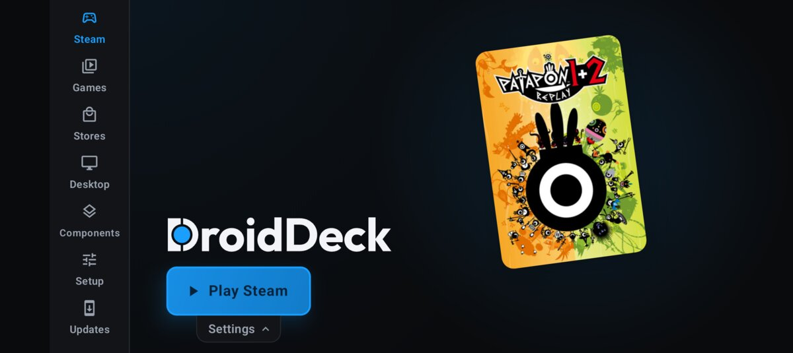
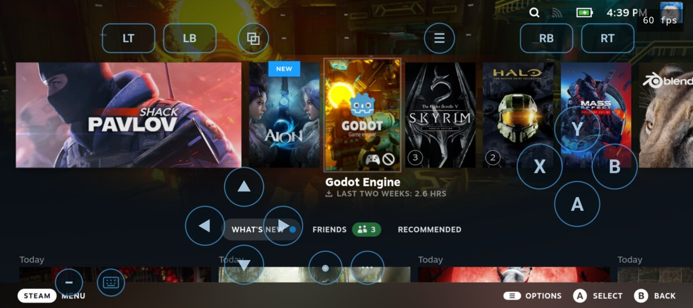
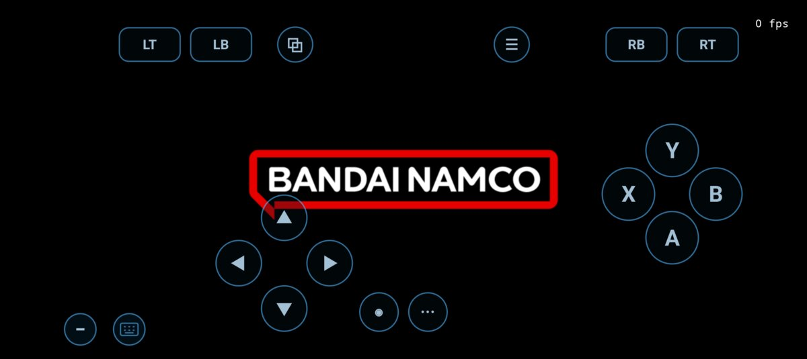
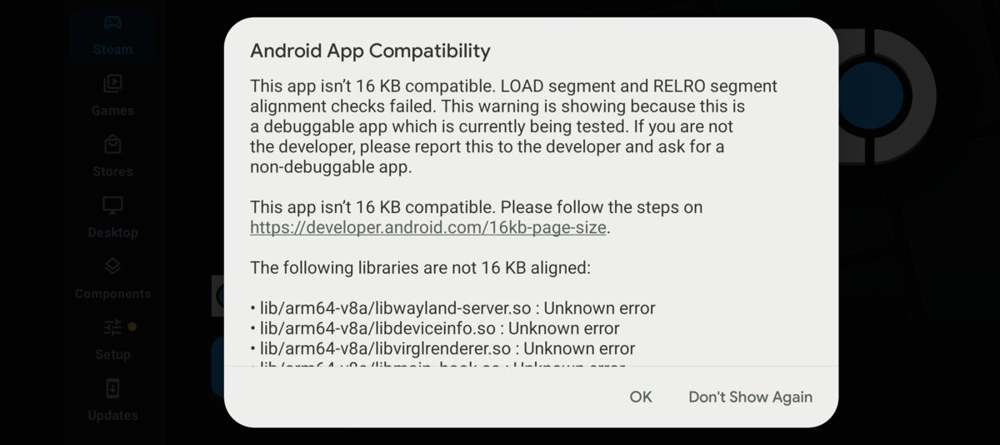

# DroidDeck-Pixel

An unofficial fork of [DroidDeck](https://github.com/Droid-Deck/DroidDeck) that runs on **Google Pixel phones and other non-Adreno GPUs** (Mali, and in principle PowerVR and Xclipse). Upstream DroidDeck only supports Qualcomm Adreno. On anything else, Steam never gets past "Starting Display and Audio".

> **Status: experimental test build.** Steam runs smoothly, and two Windows games have been played on a Pixel 10a. Expect crashes, slowdowns and rough edges. This is not affiliated with, or supported by, the DroidDeck team. Please don't send bug reports for this build to their Discord.

<p align="center">
  
  
</p>

## Contents

- [What works](#what-works)
- [Install the test build](#install-the-test-build)
- [Tips for playable performance](#tips-for-playable-performance)
- [Known issues](#known-issues)
- [Why upstream DroidDeck doesn't run on a Pixel](#why-upstream-droiddeck-doesnt-run-on-a-pixel)
- [How this fork makes it run](#how-this-fork-makes-it-run)
- [Everything that changed](#everything-that-changed)
- [Troubleshooting switches](#troubleshooting-switches)
- [Building from source](#building-from-source)
- [Credits and licences](#credits-and-licences)

## What works

Tested on a **Pixel 10a** (Tensor G4, Mali-G715 GPU, Android 17).

| What | Result |
|---|---|
| Steam client (Big Picture) | Works. Sign-in, store, library and downloads all work, at about 50–60 fps in menus. |
| Patapon 1+2 Replay (DirectX 11) | Playable. About 55 fps in levels, with sound and controller input. |
| Dark Souls Remastered (DirectX 11) | Playable. About 30 fps in most areas with the FEX preset set to **Extreme + TSO** (see [tips](#tips-for-playable-performance)). GPU memory use dropped from 3.1 to 1.4 GB in 0.4.0-pixel.2. |
| Steam overlay during a game | Opens, but can stall for a few seconds when the phone is low on memory. |
| Quick Access menu (the **…** button) | Doesn't appear. The screen dims, but the menu stays invisible and takes the input, so Steam looks frozen. Press **B** to close it. Before 0.4.0-pixel.2 this crashed and restarted Steam's interface (see [known issues](#known-issues)). |

Other Mali phones (Pixel 6–9, many Samsung and MediaTek devices) should take the same path, but nobody has tested them. Reports are welcome in the [issues](../../issues).

<p align="center">
  
</p>

## Install the test build

1. **Uninstall official DroidDeck first** if you have it. This build is signed with a different key, so Android won't install it over the official app. Uninstalling deletes the downloaded runtime and Steam data, so you'll download them again.
2. Download `DroidDeck-Pixel-*.apk` from [Releases](../../releases) and install it. It's signed with the public Android test key, so only install builds from this repo's Releases page. Android may warn that the app isn't 16 KB page-size compatible. Tap **OK**; it still runs (see [known issues](#known-issues)).
3. Allow file access when asked.
4. Turn off **Restrict child processes** in Developer options, as for upstream DroidDeck.
5. Install the Linux runtime from the app, press **Play Steam**, and sign in.

Everything else works as it does in upstream DroidDeck; its original README is kept in [docs/UPSTREAM-README.md](docs/UPSTREAM-README.md).

## Tips for playable performance

- **Pick a faster FEX preset per game.** FEX translates the game's x86 code to ARM, and most Windows games are limited by it. In the game's DroidDeck settings, set **FEX preset** to **Extreme + TSO**. That took Dark Souls Remastered from about 12 fps to the high 20s. If a game crashes with it, go back to the default.
- **Lower the in-game graphics.** Turn antialiasing, ambient occlusion, depth of field and motion blur off, and set texture quality to medium. Most compressed textures now stay compressed on the GPU, but a few formats still take 2–4 times more memory (see [known issues](#known-issues)).
- **Close other apps first.** On an 8 GB phone, Steam's interface competes with everything else for memory, and Android swapping it in and out makes the UI lag.
- **Don't charge while you play.** Charging and gaming together pushed a Pixel 10a into Android's "severe" thermal state, which cuts CPU and GPU clocks.

## Known issues

**Performance**
- Every GPU call is relayed through a separate process (see [how it works](#how-this-fork-makes-it-run)), which adds CPU overhead and latency compared to native Turnip on Adreno.
- Heavy scenes in 3D games run in the teens or low 20s. Combat can feel delayed, because several frames are queued between your input and the screen.
- Images another process may see (window buffers) are stored in a linear layout. Since 0.4.0-pixel.2, every other image uses Mali's own tiled layout.
- Entering a new area can cause a short hitch. Shaders are compiled at that moment, and compressed textures are converted on the CPU (see the next section).

**Graphics**
- Mali GPUs can't read the compressed texture formats PC games ship with (BC1–BC7). Since 0.4.0-pixel.2, BC1, BC2, BC3 and BC7 are converted to ETC2, and unsigned BC4 and BC5 to EAC, on up to four CPU threads as they're uploaded, so they stay compressed on the GPU. Signed BC4/BC5 and BC6H (HDR) textures are still decoded to uncompressed formats, which take 2–8 times more memory. ETC2 is a little lower quality than BC7.
- Mali has no clip or cull distances. Shaders that use them are rewritten so the GPU driver doesn't crash, but the clipping is ignored, so some geometry the game meant to hide may show.
- Mali also lacks wireframe drawing (`fillModeNonSolid`) and multiple viewports. Wireframe draws come out filled, and only the first viewport is used.
- Mali's shader compiler can still crash on some shaders this build doesn't rewrite yet. One was seen from a short-lived helper process at game launch. When the GPU server crashes, the game it serves freezes or exits.

**Memory**
- Opening the Steam overlay inside a game can push an 8 GB phone close to out-of-memory. Steam's UI then stalls for a few seconds until memory frees up.
- Steam's interface is laggy when the phone is short on memory. With other apps open, Android keeps swapping Steam's web UI out and back in.

**Steam's Quick Access menu**
- The **…** button opens the menu invisibly. Steam draws it in a child window on top of its main window. Gamescope's Vulkan WSI layer then stops presenting either window directly and falls back to presenting through Xwayland, and that path doesn't work under Venus yet. Press **B** to close the menu.
- Before 0.4.0-pixel.2, opening the menu also crashed Steam's GPU process, and after three crashes Steam restarted its whole interface. That's fixed: importing the menu's window buffer failed over a few kilobytes of padding (virglrenderer `0109`, Mesa `0003`).

**Display**
- Wine's hidden background window sends the compositor an invalid frame ("invalid stride 0" in the logs). It's harmless for the game, but that hidden window's connection gets dropped.

**Packaging**
- Android shows a "not 16 KB page-size compatible" warning, because some bundled libraries aren't 16 KB-aligned. Tap OK.

<p align="center"></p>

- **This is a test build, not an official-style release build.** It's an Android debug build. The Linux runtime and audio components were taken from the official DroidDeck 0.4.0 release instead of being built by DroidDeck's CI. Because of that:
  - The **Stores** feature (GOG, Epic and Amazon downloads) is missing: its download engines weren't built.
  - GOG's Galaxy service emulation ("comet") is only a placeholder.

## Why upstream DroidDeck doesn't run on a Pixel

DroidDeck runs a full Linux distribution (Arch Linux ARM) inside the app, and inside that, Steam, Proton and the games. They draw with **Turnip**, the open-source Vulkan driver from the Mesa graphics project, which only drives Qualcomm Adreno GPUs, through Qualcomm's kernel interface (`/dev/kgsl-3d0`).

A Pixel has an Arm Mali GPU with no such interface, and no open-source Mali driver that works there. So on a Pixel:

1. DroidDeck still picked Turnip, which found no Adreno GPU.
2. gamescope, the compositor Steam runs inside, found no usable Vulkan device and quit.
3. The app went back to its menu ("Starting Display and Audio", then nothing).

The phone's own Vulkan driver is an Android library. It can't be loaded into the Linux environment, because that environment uses a different C library (glibc instead of Android's bionic).

## How this fork makes it run

It uses **Venus**, a Mesa Vulkan driver built for virtual machines. Venus doesn't drive any hardware itself. It serialises every Vulkan call and sends it over a socket to a server, which replays the calls on a real GPU. Here the server runs as an ordinary Android process and replays the calls on the phone's own Mali driver:

```
 Linux side (glibc, inside DroidDeck)            Android side (app process)
 ─────────────────────────────────────           ──────────────────────────────────────
 Game → DXVK → Wine
 Steam UI → Zink        ┐
 gamescope              ┘→ Venus driver  ──socket──▶  virglrenderer render server
                           (libvulkan_virtio.so)              │
                           + this fork's Vulkan layer         ▼
                                                     Mali's own Vulkan driver
                                                     (/vendor/lib64/egl/libGLES_mali.so)
```

The render server is [virglrenderer](https://gitlab.freedesktop.org/virgl/virglrenderer) 1.3.0. It's built with the Termux project's Android patches (xMeM's Venus-on-Android work) plus this fork's own fixes. GPU memory that both sides need to see is allocated as Android hardware buffers and shared as dma-bufs.

On top of Venus sits a small Vulkan layer, `VK_LAYER_DROIDDECK_venus`. It fills the gaps between what DXVK, gamescope and Steam expect and what Mali offers.

Full technical notes for each patch and the layer are in [tools/venus/README.md](tools/venus/README.md).

## Everything that changed

Compared with upstream DroidDeck (`main` as of October 2026):

### Android app

| File | Change |
|---|---|
| `app/src/main/java/com/droiddeck/launcher/gpu/VenusBridge.java` | **New.** Decides when to use the bridge (any non-Adreno GPU). Unpacks the guest-side driver and layer, writes their Vulkan manifests, sets the session's environment, and starts and stops the render server. |
| `app/src/main/java/com/droiddeck/launcher/gpu/TurnipDriver.java` | Picks no Turnip driver on non-Adreno GPUs, instead of Turnip for a GPU that isn't there. |
| `app/src/main/java/com/droiddeck/launcher/session/SessionService.kt` | Starts the Venus bridge for a session on non-Adreno devices. |
| `app/src/main/java/com/droiddeck/launcher/runtime/LinuxRuntime.java` | Finds the GPU device on Mali (`/dev/mali0`) and PowerVR (`/dev/pvrsrvkm`) as well as Adreno (`/dev/kgsl-3d0`). Exposes it inside Linux as a render node (`/dev/dri/renderD*`), which gamescope requires. |
| `app/build.gradle` | New `buildVenus` task that builds the bridge from source. `-PskipVenus=true` leaves it out. |

### Linux-side helpers

| File | Change |
|---|---|
| `tools/linuxfs/preload/drm.c` | DroidDeck's fake GPU-buffer handles, previously Adreno-only, now work for any GPU device. Without this, gamescope failed to import buffers on Mali. |
| `tools/linuxfs/preload/venus.c` | **New.** Undoes a Steam setting (`LIBGL_KOPPER_DISABLE`) that broke Steam's web UI rendering on Venus ("failed to acquire a gl context"). |

### The bridge (`tools/venus/`, all new)

- **`build-virglrenderer.sh`.** Builds everything from source, with every download pinned by checksum:
  - virglrenderer and libepoxy for Android, with the NDK.
  - Mesa 26.2.4's Venus driver for the Linux side, against Arch Linux ARM packages.
  - The Vulkan layer.
- **virglrenderer patches.**
  - Termux's patches for Android: hardware-buffer memory, ashmem, and build fixes.
  - This fork's patches:
    - `0100`: compile fixes for virglrenderer 1.3.0.
    - `0101`: DRM-modifier and dma-buf export answers that gamescope needs. Also fixes a protocol bug that crashed Zink.
    - `0102`: keeps Android's graphics libraries loaded. Unloading them crashed worker threads.
    - `0103`: fixes a lock used after it was destroyed. Android aborts on that.
    - `0104`: a new protocol command that lets a window share its GPU buffer with the compositor (vtest protocol 5). Without it, Steam showed the same few frames over and over.
    - `0105`: fixes an infinite loop when importing those buffers.
    - `0106`: extra diagnostics.
    - `0107`: extra diagnostics.
    - `0108`: lets images no other process sees keep Mali's tiled layout. Only window buffers stay linear.
    - `0109`: imports a shared window buffer at its real size, when the importing image asks for a few pages more.
    - `0110`: answers a linear image's row layout from a plain twin image when Mali reports a row pitch of 0.
- **Mesa patches.**
  - `0001`: the guest side of the buffer import.
  - `0002`: fixes a race in Venus where its present thread and the game's thread built GPU submissions in the same scratch buffer. It crashed games at random in `vkQueueSubmit2`.
  - `0003`: accepts a shared buffer up to 64 KB smaller than the importing image asks for (padding), and logs the reason when an import is refused.
- **`layer/venus_layer.c`, the Vulkan layer.**
  - Gives gamescope a render node.
  - Stands in for two things Mali lacks for gamescope and DXVK:
    - the semaphore file-descriptor extension;
    - the features DXVK requires: BC texture compression, wireframe, multiple viewports, clip and cull distances, and `robustBufferAccess2`.
  - Converts BC textures to ETC2/EAC on the CPU, on up to four threads (`etc2_encode.h`). Formats ETC2 can't hold are decoded with `bcdec`.
  - Steers images that no other process sees into device-only memory, so they keep Mali's tiled layout.
  - Logs every failed memory allocation with what was asked for.
  - Rewrites shaders that use clip or cull distances, so Mali's compiler doesn't crash on them.
  - Has an optional crash tracer.

## Troubleshooting switches

Put `KEY=VALUE` lines in `Android/data/com.droiddeck.launcher/files/droiddeck-env` on the phone, from adb or a file manager that can reach the app's folder. They apply from the next session. (The old `Download/droiddeck-env` location is ignored.)

| Line | Effect |
|---|---|
| `DROIDDECK_VENUS_SEGV_TRACE=1` | Prints a backtrace for crashes and aborts in the game's log. |
| `DROIDDECK_VENUS_BC_FULL=1` | Stores BC1 textures at 32 bits instead of 16, if textures look wrong. |
| `DROIDDECK_VENUS_NO_FAKE=1` | Stops the layer standing in for missing features. DXVK games won't start, but it helps tell a layer bug from a game bug. |
| `DROIDDECK_VENUS_NO_ETC2=1` | Decodes BC textures to uncompressed formats instead of converting them to ETC2/EAC, if textures look wrong. Uses much more memory. |
| `DROIDDECK_VENUS_LINEAR=1` | Stores every image in a linear layout, as before 0.4.0-pixel.2. |
| `DROIDDECK_VENUS_MEMORY_LOG=1` | Logs GPU memory per memory type, every 128 MB. |
| `DROIDDECK_VENUS_STAGING_LOG=1` | Logs the memory used to stage texture conversions. |
| `DROIDDECK_VENUS_NO_BC_DECODE=1` | Skips texture decoding (textures will be blank). Diagnostic only. |
| `PROTON_LOG=1` | Proton's full log, in `steam-<appid>.log`. It slows games down a lot. |

To turn the whole bridge off, create an empty file `Download/droiddeck-no-venus`.

## Building from source

The app builds the way upstream DroidDeck does: `tools/build_local.sh` prepares the Linux runtime and native components in Docker, then runs Gradle (see [docs/UPSTREAM-README.md](docs/UPSTREAM-README.md#build)). This fork adds one Gradle task, `buildVenus`, which runs `tools/venus/build-virglrenderer.sh`. That script downloads pinned sources and Arch Linux ARM packages and cross-compiles the bridge. On top of upstream's requirements, it needs:
- the Android NDK (27);
- `meson`, `ninja` and `pkg-config`;
- `bison` and `flex`;
- `wayland-scanner`;
- Python 3 (it installs its own `mako`, `pyyaml` and `packaging` in a private virtualenv).

Pass `-PskipVenus=true` to build without the bridge.

The test APK in Releases wasn't built that way. It's a Gradle debug build (`./gradlew assembleDebug -PskipRust=true`) using the runtime payload extracted from the official 0.4.0 APK. The full `tools/build_local.sh` path with the bridge hasn't been tested yet.

## Credits and licences

- [DroidDeck](https://github.com/Droid-Deck/DroidDeck) by the DroidDeck team: GPL-3.0. This fork is GPL-3.0 too (see [LICENSE](LICENSE)).
- [virglrenderer](https://gitlab.freedesktop.org/virgl/virglrenderer): MIT.
- [Mesa](https://mesa3d.org) (Venus driver): MIT.
- xMeM's [Venus-on-Android patches](https://github.com/xMeM/termux-packages) and the [Termux](https://github.com/termux/termux-packages) `virglrenderer-android` package.
- [bcdec](https://github.com/iOrange/bcdec) by Sergii Kudlai: MIT / Unlicense.
- Valve's Proton, Steam and gamescope; [FEX-Emu](https://github.com/FEX-Emu/FEX); [DXVK](https://github.com/doitsujin/dxvk).

The Pixel bring-up was done with Claude Code (Anthropic).
